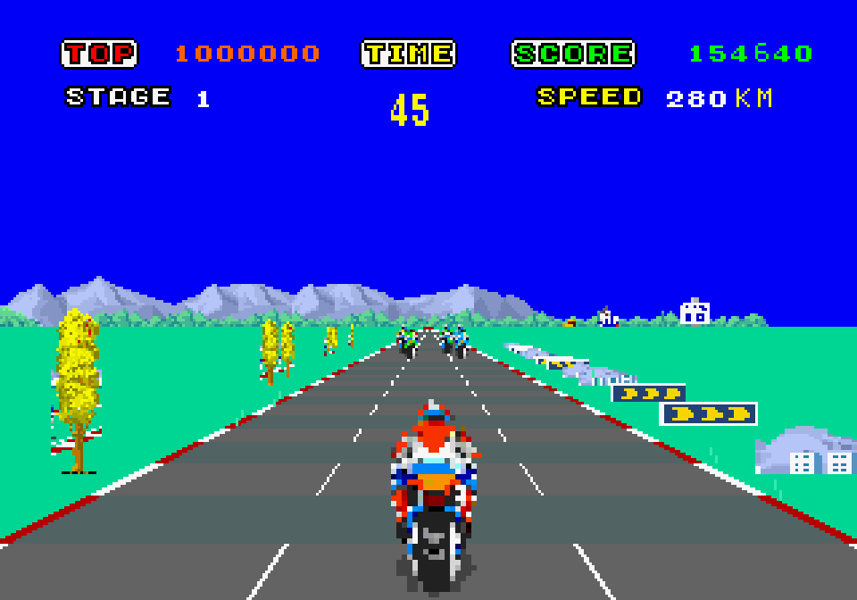

# Hang-On — Arcade Reconstruction / x64 Assembly

Игра для Windows x64, переработанная по скриншотам и записи прохождения
аркадного **Hang-On, Sega, 1985**. Игровая логика, растеризация, шрифт,
масштабирование спрайтов и синтез звука написаны на ассемблере x86-64.



## Запуск

Готовая сборка для Windows: [скачать EXE или полный ZIP-проект](https://github.com/Cesssna172/hang-on-asm/releases/latest).
При скачивании только исходников сначала выполните шаги из раздела «Сборка».

Откройте `run.bat` или `bin/hangon.exe`. Для готового EXE достаточно Windows 10/11 x64.
Все используемые DLL входят в Windows: kernel32, user32, gdi32, winmm.
Графика встроена в EXE, Python и ROM-файлы для игры не требуются.

| Клавиша | Действие |
|---|---|
| Enter | Начать гонку, пауза/продолжение, подтвердить имя |
| Вверх / W | Газ |
| Вниз / S / Пробел | Тормоз |
| Влево / A, Вправо / D | Управление мотоциклом |
| P | Пауза/продолжение |
| R | Начать гонку заново |
| M | Включить/выключить звук |
| Esc | Титульный экран, затем выход |
| Буквы A–Z на экране имени | Ввод инициалов |
| Стрелки на экране имени | Выбрать букву и её позицию |

Пять этапов нужно пройти до истечения времени. В начале даётся 75 секунд,
контрольная точка добавляет 60 секунд. Максимальная скорость — 280 км/ч.
Касание соперника вызывает дрожание и потерю скорости. Выезд далеко на обочину
на большой скорости вызывает аварию с кувырками, огнём и упавшим гонщиком.
После завершения показываются результаты и таблица семи лучших результатов.
При попадании в таблицу можно ввести три буквы. Рекорды живут до закрытия игры.
При потере фокуса гонка ставится на паузу.

## Обновление ощущения скорости

Движение по миру ускорено втрое относительно предыдущей сборки. Длина этапов
увеличена в той же пропорции, поэтому общая длительность гонки сопоставима.
Более низкая скорость соперников делает обгоны заметнее. После 170 км/ч появляются
короткие следы движения на периферии, а положение горизонта слегка меняется с разгоном.
Крупные полосы разметки и придорожные объекты теперь проходят мимо быстрее.

Мотоциклы и гонщики переведены на более крупную сетку 2 × 2 пикселя.
В игровых экранах удалены логотип и надписи SEGA, брендированные вывески
заменены указателями со стрелками. Исходные эталоны и сведения об авторстве
сохранены в документации.

## Изменения относительно первой версии

* Кадр 320 × 224 и оформление исходной аркады.
* Графика логотипа, стартовой решётки, мотоциклов, взрыва, фонов и экранов
  восстановлена по найденным кадрам. Современные карточки меню убраны.
* Семь отдельных поз наклона, произвольное перспективное масштабирование,
  анимация логотипа, светофор и несколько фаз аварии.
* Пять окружений с цветами, проверенными по записи прохождения.
* Пять отдельных профилей трассы, соперники на высокой скорости, таблица рекордов.
* Равномерный шаг симуляции 60 Гц с накоплением долей миллисекунды.

Эта версия значительно ближе к аркаде по видимым элементам, но полное покадровое
совпадение не подтверждено. Трассы, физика, размещение объектов и тайминги
реконструированы, отдельные изображения получены из видео со сжатием.
Подробные источники и отличия перечислены в [REFERENCES.md](docs/REFERENCES.md).

## Сборка

Нужен MinGW-w64 GCC с GNU assembler, например пакет `mingw-w64-x86_64-gcc`
из MSYS2 MINGW64. GCC используется как драйвер ассемблера и компоновщика.
Код C/C++ и стандартная библиотека C в EXE отсутствуют.

```powershell
powershell -NoProfile -ExecutionPolicy Bypass -File .\build.ps1
powershell -NoProfile -ExecutionPolicy Bypass -File .\test.ps1
```

При другом расположении компилятора:

```powershell
.\build.ps1 -Compiler 'C:\path\to\mingw64\bin\gcc.exe'
```

Готовые бинарные изображения в `assets/generated` входят в исходный проект.
Их изменение выполняется дополнительным инструментом подготовки ресурсов,
для которого нужны Python 3 и Pillow 13+:

```powershell
py -3 -m pip install 'Pillow>=13'
py -3 .\tools\build_assets.py
.\build.ps1
```

## Проверки и упаковка

`test.ps1` запускает ассемблерный `--self-test`. Проверяются обратный отсчёт,
разгон, управление, тормоз, пауза, контрольные точки, победа, истечение времени,
обочина, касание соперника, большая авария, переход к рекордам и ввод имени.
Непрерывный прогон всех пяти этапов изолирует трассу и таймер от трафика,
а столкновения проверяются отдельно.

Интеграционная проверка требует Python 3 со стандартной библиотекой и `nm.exe`
из MinGW-w64. Предварительно закройте игру:

```powershell
py -3 .\tests\ui_smoke.py
```

Она проверяет работающий EXE, оконные сообщения, управление, паузу, звуковые
PCM-буферы, семь различных поз наклона, фазы аварии, этапы и экраны завершения.
Сохраняются реальные кадры рендера и последовательность езды с работающей физикой
в `build/screenshots`. Для проверки отдельных фаз и экранов тест устанавливает
состояние собственного дочернего процесса.

```powershell
.\package.ps1
```

Создаётся `hang-on-asm.zip` рядом с папкой проекта. Архив содержит EXE,
все исходники, встроенные ресурсы, материалы сравнения, документацию и тесты.

## Структура

| Путь | Назначение |
|---|---|
| `src/main.s` | Окно Windows, сообщения, цикл 60 Гц, масштабирование |
| `src/game.s` | Физика, состояния, соперники, трассы, рекорды, самопроверки |
| `src/render.s` | Программная графика, шрифт, перспективное масштабирование |
| `src/audio.s` | Тройная буферизация PCM, синтез двигателя |
| `src/data.s` | Состояние, палитры, профили трасс, строки |
| `src/art.s` | Включение пиксельных ресурсов через `.incbin` |
| `assets/reference` | Исходные кадры сравнения |
| `assets/generated` | Встраиваемые изображения и шрифт |
| `tools/build_assets.py` | Подготовка изображений во время разработки |
| `tests/ui_smoke.py` | Интеграционные проверки Windows |

Синтаксис — GNU assembler Intel, соглашение вызовов Windows x64 ABI,
точка входа `start`, компоновка с `-nostdlib`.

## Авторство

Написанный код распространяется по MIT, см. `LICENSE`. Оригинальная графика Hang-On
принадлежит Sega. Источники изображений и записи перечислены в `docs/REFERENCES.md`.
